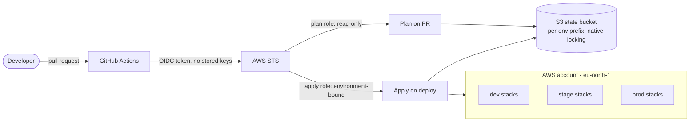
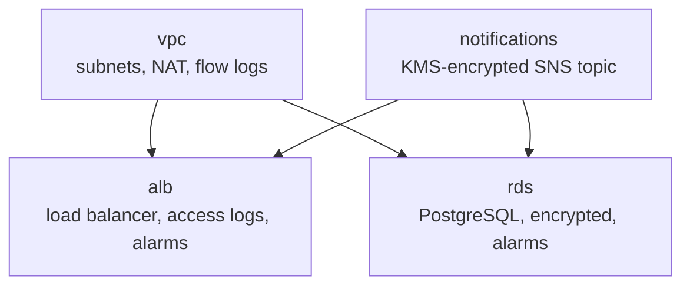

# multi-env-infra

[](https://github.com/princengcobo186-sketch/multi-env-infra/actions/workflows/ci.yml)

Multi-environment AWS infrastructure built from small, tested Terraform modules, composed
per environment with Terragrunt, and delivered only through GitHub Actions: no one applies
changes from a laptop after the one-time bootstrap.

**Status:** the modules, environment definitions and pipelines are complete and pass their
checks. Nothing is deployed yet; the first deployment follows the bootstrap in
[Getting started](#getting-started).

## What this demonstrates

- **Modular Terraform** with mocked unit tests (`terraform test` + `mock_provider`), so module
  behaviour is verified in seconds with no cloud account.
- **DRY environments**: one shared definition per stack (`live/_envcommon/`), with each
  environment differing only in a short `env.hcl` (CIDRs, instance sizes, NAT mode,
  deletion protection).
- **Keyless CI/CD**: GitHub Actions authenticates to AWS with OIDC. There are no stored AWS
  access keys. Separate read-only *plan* and environment-bound *apply* roles per environment.
- **Release-based promotion**: a version tag is the artifact. The same tag is promoted
  dev -> stage -> prod, never rebuilt. Rollback is redeploying the previous tag.
- **Secure defaults**: encrypted state with versioning and native S3 locking, encrypted and
  private databases, KMS-encrypted alert topic, VPC flow logs, TLS-only bucket policies.
- **Cost control**: a guarded teardown workflow for dev and stage.

## Architecture



Each environment is the same four stacks, applied in dependency order:



| | dev | stage | prod |
|---|---|---|---|
| VPC CIDR | `10.10.0.0/16` | `10.20.0.0/16` | `10.30.0.0/16` |
| NAT gateways | one shared | one shared | one per AZ |
| RDS | `db.t4g.micro`, single AZ | `db.t4g.micro`, single AZ | `db.t4g.medium`, Multi-AZ |
| Deletion protection / final snapshot | off / skipped | off / skipped | on / taken |
| HTTPS certificate | optional | optional | required |

All environments share one AWS account and one Region (`eu-north-1`). Isolation comes from
separate state prefixes, per-environment IAM roles and naming, not separate accounts. That
trade-off, and what would change with an account per environment, is in
[docs/architecture.md](docs/architecture.md).

## Repository layout

```
bootstrap/    one-time layer: state bucket and per-environment GitHub OIDC roles
modules/      reusable Terraform modules (vpc, alb, rds, notifications), each with tests
live/         Terragrunt: root.hcl (backend + provider), _envcommon/ (shared stacks),
              dev/ stage/ prod/ (env.hcl and one terragrunt.hcl per stack)
docs/         architecture decisions and the operations runbook
.github/      workflows: ci, plan, release, deploy, destroy
```

## CI/CD

| Workflow | Trigger | What it does |
|---|---|---|
| `ci.yml` | pull request, push to `main` | `terraform fmt`, `terragrunt hcl fmt/validate`, `tflint`, then `validate` + `test` for every module. No cloud credentials. |
| `plan.yml` | pull request | Read-only `terragrunt plan` of dev with the plan role. Skipped on forks. |
| `release.yml` | tag `vX.Y.Z` | Re-runs CI, publishes a GitHub Release (source archive, checksum, provenance attestation), deploys that tag to dev. |
| `deploy.yml` | manual, or from release | Applies one tag to one environment with that environment's apply role. |
| `destroy.yml` | manual | Destroys dev or stage after a typed confirmation. Prod is excluded. |

Promotion to stage and prod is the same `deploy.yml` run with the same tag. Details and
rollback are in [docs/operations.md](docs/operations.md).

## Getting started

### Prerequisites

- An AWS account with `eu-north-1` available, and permission to create IAM roles, an OIDC
  provider and an S3 bucket for the one-time bootstrap. Confirm your account plan supports
  RDS, load balancers and NAT gateways before deploying.
- [asdf](https://asdf-vm.com/); tool versions are pinned in `.tool-versions`:
  ```sh
  asdf plugin add terraform && asdf plugin add terragrunt && asdf plugin add tflint
  asdf install
  ```
- The GitHub CLI (`gh`) if you want to script repository configuration.

### Check everything locally (no AWS needed)

```sh
terraform fmt -check -recursive
terragrunt hcl fmt --check --working-dir live

for m in modules/*/; do
  terraform -chdir="$m" init -backend=false -input=false
  terraform -chdir="$m" test
done
```

### Bootstrap once

The state bucket and the CI roles must exist before any workflow can run, so this is the
only step done outside Actions. Use short-lived credentials and read the plan first.

```sh
cd bootstrap
terraform init
terraform plan -var github_repository=<owner>/<repo> -out=tfplan   # read every line
terraform apply tfplan
rm -f tfplan                       # plans embed secrets; never commit or upload them
terraform output                   # role ARNs for the next step
```

### Configure GitHub

Nothing secret lives in the repository. Set these in the repository settings:

| Where | Name | Value |
|---|---|---|
| Repository variable | `AWS_ACCOUNT_ID` | the AWS account ID |
| Repository variable | `AWS_PLAN_ROLE_ARN_DEV` | `plan_role_arns["dev"]` from bootstrap |
| Repository secret | `ALERT_EMAILS` | comma-separated alert addresses (may be empty) |
| Environment `dev` / `stage` / `prod` variable | `AWS_APPLY_ROLE_ARN` | that environment's `apply_role_arns` entry |
| Environment variable | `CERTIFICATE_ARN` | ACM certificate ARN; **required for prod**, optional elsewhere |

Create the `dev`, `stage` and `prod` environments, and add required reviewers to `prod`.

### Release and deploy

```sh
git tag -a v0.1.0 -m "v0.1.0" && git push origin v0.1.0   # CI, release, deploy to dev
```

Then promote the same tag through **Actions > Deploy > Run workflow**.

## Cost and teardown

NAT gateways, load balancers and databases bill by the hour even when idle. Run **Actions >
Destroy** for dev and stage when you are not using them, and set a spend limit in your AWS
account settings. The state bucket and CI roles are left in place.

## Security model

- **No long-lived credentials.** CI uses OIDC; plan roles trust only this repository's pull
  requests, apply roles trust only a specific GitHub environment.
- **Fails closed on the wrong account.** `TG_ACCOUNT_ID` is required and feeds the
  provider's `allowed_account_ids`, so credentials for another account cannot apply.
- **State is isolated per environment** by key prefix and IAM, and is versioned and encrypted.
- **Secrets stay out of code and artifacts.** Alert addresses are a secret, database
  passwords are generated and held by AWS Secrets Manager, and plan files are never
  uploaded.
- **Actions are pinned by commit SHA** and updated through Dependabot pull requests.
- **Known gaps:** the apply roles use service-level wildcards, and `ReadOnlyAccess` is
  account-wide. Both are documented in `bootstrap/github_oidc.tf` and tightened by moving
  to an account per environment. Plan logs on a public repository are publicly readable.

## Roadmap

- Tighten apply-role policies from CloudTrail data.
- Add an application stack that consumes the load balancer and database.
- Account-per-environment layout and an automated promotion-order check.
- Infrastructure security scanning in CI.
